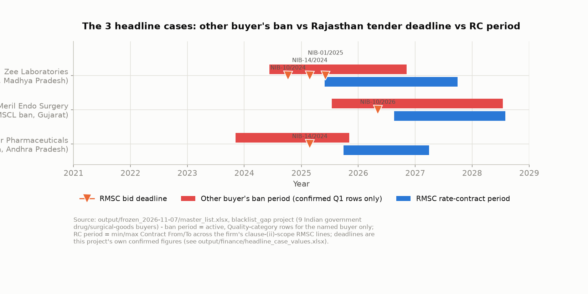

# The Blacklist Gap

When one Indian government drug buyer bans a supplier for bad quality, do other buyers keep that supplier eligible?

India has no single national blacklist for drug suppliers. This project collects the public blacklist (debarment / Not of Standard Quality) records of **9 Indian government drug and medical-supply procurement buyers** and checks them against each other, and against Rajasthan's rate contracts, to see whether a supplier banned by one buyer for a quality problem stays eligible to supply another.



> **Read this first.** Buyers may have reasons not visible in public records, and the firms and buyers named here were not contacted for comment. Every finding is a **possible breach of a tender clause as worded**, not a finding of fraud or illegal conduct. See the Limits section of the full report before drawing a conclusion from any single figure.

**Start here:** [`write_up/One_page_summary.md`](write_up/One_page_summary.md) (also as [PDF](write_up/One_page_summary.pdf)) for the short version, or [`write_up/Blacklist_Gap_Report.md`](write_up/Blacklist_Gap_Report.md) (also as [Word](write_up/Blacklist_Gap_Report.docx)) for the full report.

## Key numbers
- **804** ban records across 9 buyers; **371** are quality findings.
- **63 firms** are actively banned by 2 or more buyers at once.
- **37 rows** are a formal, statutory "Not of Standard Quality" finding (Q1); **334** are a quality finding without a named statutory lab (Q2).
- **3 headline cases** (Zee Laboratories, Meril Endo Surgery, Nestor Pharmaceuticals): banned by one state for a statutory quality finding, and holding Rajasthan rate contracts on Rajasthan's bid deadline. Estimated 2-year contract value (not amount paid): Rs 25-46 crore, Rs 1-2.3 crore and Rs 3-5.3 crore.
- **5 firms** were separately found concealing a ban from another buyer in their own affidavit.
- **9 of 22** Karnataka records are currently stayed by the High Court.

## Folder map

```
write_up/
  Blacklist_Gap_Report.md / .docx    - the full report
  One_page_summary.md / .pdf         - a 1-page summary with 1 chart
  Resume_lines.md                    - 3 short summaries of the project
  fact_check.xlsx                    - a claim-by-claim check of every
                                        number, date and name in write_up/,
                                        plus a check of the wording rules
  cases/
    Zee.md, Meril.md, Nestor.md      - one file per headline case: timeline,
                                        every source document (with page
                                        numbers) and the estimated contract value

output/
  frozen_2026-11-07/                 - the point-in-time data snapshot the
                                        report and every case file are built
                                        from (master list, per-buyer lists,
                                        rate contracts, case files, and a
                                        README with full row counts)
  finance/headline_case_values.xlsx  - the 2-year estimated-contract-value
                                        model behind section 5 of the report
  analysis/                          - network chart, summary-number
                                        workbook, contagion test, and the
                                        4 charts used in the report
  review/                            - document checks the findings rely on
                                        (clause text, lab names, OCR
                                        corrections, scanned tender
                                        quantities)
  source_issues.csv                  - every data-quality issue found along
                                        the way, logged rather than silently
                                        fixed or hidden

scripts/                             - the Python pipeline that built every
                                        file above (see "How to re-run")
PROGRESS_LOG.md                      - the full, append-only build log: what
                                        was asked, what was done, what was
                                        found, in order
PROJECT_RULES.md                     - the standing working rules the
                                        project followed (logging, backups,
                                        OCR handling, no auto-merging)
```

## How to re-run

Requires Python 3.14+ and the packages in `requirements.txt` (`pip install -r requirements.txt`). OCR steps also need the Tesseract OCR program with its Hindi language data, and `06_gmscl_archive_playwright.py` needs a Playwright browser (`playwright install chromium`). From the project root:

```
py scripts\01_download.py
py scripts\02_extract_pdfs.py
py scripts\03_build_master.py
py scripts\03_assam_master.py
py scripts\04_pmbi.py
py scripts\05_gmscl.py
py scripts\07_mpphscl.py
py scripts\08_rmsc.py
py scripts\09_kmscl.py
py scripts\13_bmsicl.py
py scripts\16_ksmscl.py
py scripts\10_merge_master.py            REM auto-runs 11_cross_buyer_pairs.py, 12_candidate_gaps.py
py scripts\15_rate_contracts.py
py scripts\build_rc_vs_bans.py
py scripts\build_case_files.py
py scripts\build_concealment_cases.py
py scripts\build_headline_case_values.py
py scripts\17_network_chart.py
py scripts\build_summary_numbers.py
py scripts\build_contagion_test.py        REM needs a local copy of the researcher's separate
                                           REM CDSCO NSQ dataset (Manufacturer Quality Risk Index
                                           REM project) - see the script's docstring for the path
py scripts\build_analysis_charts.py
py scripts\build_write_up_exports.py
```

Each buyer script re-fetches that buyer's own public pages and PDFs (robots.txt respected throughout; no login, paywall or access control was bypassed). The report, case files and `output/finance/headline_case_values.xlsx` read **only** from the frozen snapshot (`output/frozen_2026-11-07/`), so re-running the scrapers does not silently change the report's numbers.

## Data sources

Each buyer's own public website or published PDF list. Karnataka's 3 scanned blacklist PDFs were transcribed by hand directly from the page images (not OCR). The exact URL for every record is in the "Source link" column of `output/frozen_2026-11-07/master_list.xlsx`, and in each case file's source list. See section 2 ("Data") of the full report for the buyers, row counts and date ranges, and section 9 ("Sources") for every document cited.

**Not included in this repository:** the raw downloaded PDFs and HTML pages (`data/raw/`, about 310 MB), the OCR text extracted from them, older data snapshots, and any individual person's name. This review reports at the company level only.
